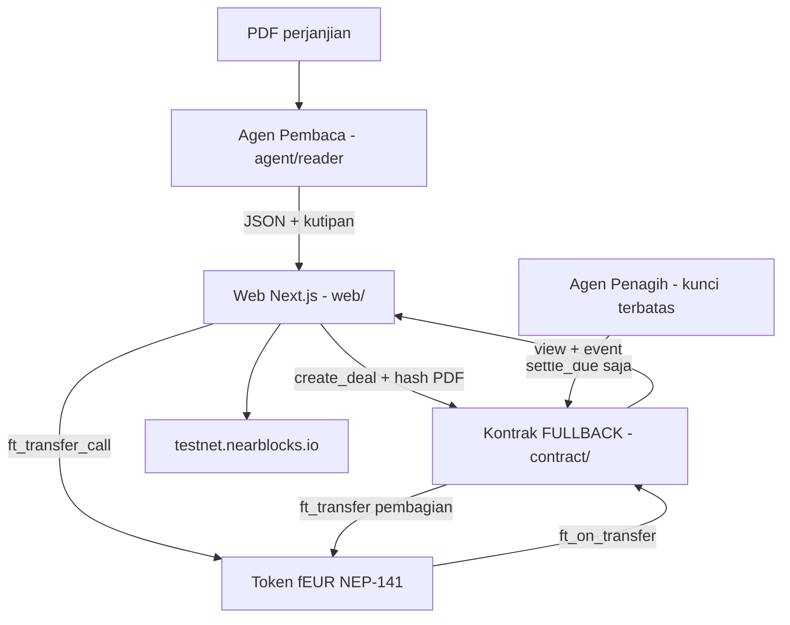
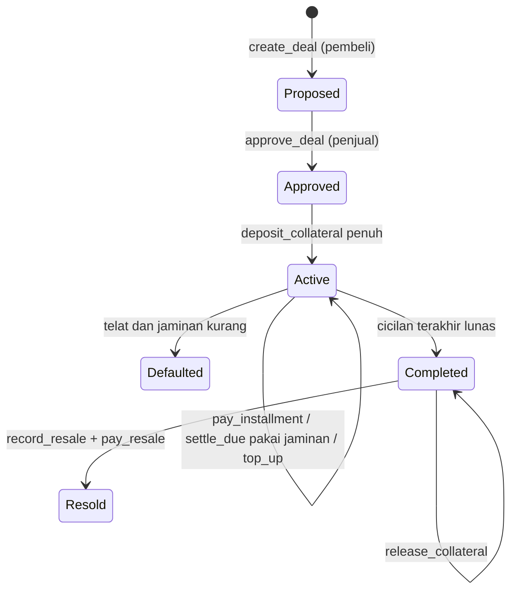
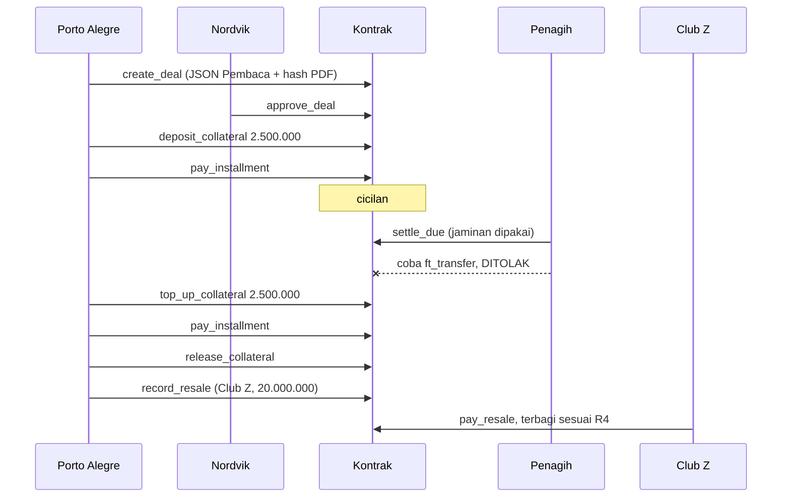

# FULLBACK - Plan

Dokumen ini adalah satu-satunya sumber kebenaran untuk tim FULLBACK (NEAR HACKATHON "Build Beyond Boundaries").
Setiap sesi Claude Code wajib membaca file ini sebelum menulis kode.
Kalau isi file lain bertentangan dengan file ini, file ini yang menang, lalu tanyakan ke manusia.

---

## Goal Capsule

- **Objective:** Membangun FULLBACK sebagai aplikasi umum untuk klub sepak bola: dua klub yang bertransaksi bisa mengubah perjanjian transfer menjadi kontrak di NEAR yang menagih cicilan, memegang jaminan, membayar sell-on, dan menyalurkan royalti SSB/akademi (Academy royalties) secara otomatis. Fokus utama: melindungi klub penjual dari cicilan yang menunggak. FIFA atau federasi bisa memantau semua deal (hanya melihat).
- **Urutan kerja:** Fase 1 membangun web umum yang bisa dipakai klub mana pun, tanpa unsur demo. Fase 2 (setelah Fase 1 jalan) menambah Judge demo mode dengan skenario Lucas.
- **Bukti untuk juri (Fase 2):** Juri membuka demo online, menjalankan skenario fiktif Lucas (data demo saja, bukan isi produk), dan melihat sendiri di testnet NEAR bahwa cicilan, jaminan, sell-on, dan Academy royalties dibayar sesuai isi kontrak, dengan link explorer untuk setiap transaksi.
- **Means:** Smart contract Rust di NEAR testnet yang memegang token mock fEUR (KTD1, KTD2), agen AI Pembaca + Penagih (KTD6, KTD7), dan web Next.js berbahasa Inggris dengan Dashboard klub dan Judge demo mode (KTD8, KTD14).
- **Authority:** PLAN.md > `contract/INTERFACE.md` > `agent/schema.ts` > kode. Angka cerita demo Lucas (R1–R4) terkunci dan tidak boleh diubah oleh AI. Lucas hanya mengisi demo; copy produk di web tidak boleh bercerita tentang Lucas.
- **Execution profile:** 4 orang, masing-masing menjalankan Claude Code di folder miliknya sendiri. Tanpa branch dan tanpa PR: semua commit langsung ke `main` dengan aturan folder (KTD10).
- **Siapa yang menyelesaikan dan mengirim:** Orang 4 (koordinator) yang menekan tombol submit. Hanya manusia yang boleh membuat repo publik, posting di X, dan mengisi form.
- **Stop conditions:** Berhenti dan tanya manusia jika (a) perlu mengubah file di luar folder sendiri, (b) perlu mengubah `INTERFACE.md`, `schema.ts`, atau angka terkunci, (c) diminta memakai mainnet atau uang asli, (d) `git pull` menghasilkan konflik, (e) tes kontrak gagal dan penyebabnya ada di folder orang lain.
- **Deadline:** Submit ditutup Sabtu 14 Nov 2026 23:59 UTC = Minggu 15 Nov 06:59 WIB. Target tim: submit Sabtu 14 Nov malam WIB.

---

## Product Contract

### Summary

FULLBACK adalah aplikasi untuk klub sepak bola yang mengubah perjanjian transfer pemain menjadi kontrak di blockchain NEAR yang menagih dan membagi uangnya sendiri, dari transfer fee dan cicilannya sampai royalti SSB/akademi pembina (di web disebut **Academy royalties**).
Sasaran utamanya klub penjual yang menjual pemain secara cicilan dan takut pembelinya menunggak; klub pembeli, SSB/akademi, dan pemegang sell-on ikut terlindungi.
Agen AI membaca PDF perjanjian dan mengeluarkan angka-angka beserta kutipan pasalnya.
Kontrak memegang jaminan, menagih cicilan, memakai jaminan saat pembeli telat, dan otomatis membagi uang ke penjual, SSB/klub pembina (Academy royalties, setara jatah pembinaan/solidarity FIFA 5%), dan pemegang sell-on saat pemain dijual lagi.
Setiap klub melihat semua deal-nya di Dashboard: sebagai penjual, sebagai pembeli, dan royalti yang diterima sebagai akademi.
FIFA atau federasi nasional punya Federation view untuk memantau semua deal, cicilan telat, deal yang Defaulted, dan Academy royalties yang sudah tersalurkan. Federasi hanya melihat, tidak bisa mengubah apa pun.
Sidik jari PDF disimpan on-chain supaya siapa pun bisa memeriksa bahwa PDF tidak diubah.
Skenario Lucas (R1–R4) dan kasus nyata di Problem Frame hanya dipakai untuk demo dan pitch, bukan sebagai isi produk. Skenario Lucas diibaratkan klub biasa yang memakai FULLBACK untuk menjual pemain.

### Problem Frame

Klub sering tidak dibayar meski perjanjian transfernya jelas.
Botafogo belum membayar €8 juta ke Ludogorets dan dihukum larangan transfer 3 periode oleh FIFA (Apr 2026).
Fenerbahçe diperintahkan membayar Sevilla sekitar $2,95 juta dari transfer €19,5 juta yang dicicil 8 kali selama 4 tahun.
Zamalek menumpuk utang sekitar $6,17 juta di beberapa kasus.
FIFA Clearing House hanya menangani jatah pembinaan (sekitar $1 miliar dibayarkan, 1.665 klub terdaftar), tidak memakai blockchain, dan tidak menjamin cicilan maupun sell-on.
Klub kecil harus menggugat ke FIFA, menunggu bertahun-tahun, dan bunga keterlambatan standarnya hanya 8% per tahun.

### Key Decisions

- **FULLBACK dipilih, bukan JURAGAN atau ClipSettle.** ClipSettle sudah ramai pesaing (Whop Content Rewards, Distro, FlowBack). FULLBACK punya masalah nyata yang terdokumentasi. Governs R1–R16. (session-settled: user-directed — chosen over JURAGAN dan ClipSettle: masalah global nyata dan bisa didemokan)
- **Data cerita fiktif tapi realistis (Lucas, klub fiktif), bukti masalah dari kasus nyata.** Nama klub asli tidak dipakai di demo. Governs R1–R4, R20. (session-settled: user-approved — chosen over memakai kontrak asli: kontrak asli tidak publik dan berisiko hukum)
- **Testnet dengan uang mainan fEUR, 1 fEUR = €1.** NEAR Intents tidak punya testnet, jadi hanya opsional di mainnet. Governs R5, R18. (session-settled: user-approved — chosen over mainnet uang asli: gratis dan aman untuk pemula)
- **FULLBACK adalah produk umum untuk klub; Lucas hanya data demo.** Copy web membahas klub penjual, klub pembeli, SSB/akademi, dan pemegang sell-on secara umum. Lucas muncul di Judge demo mode, di deal demo, dan di satu teaser "See it in action" di Beranda. Governs R1–R4, R21, R22. (session-settled: user-directed, 11 Nov — chosen over website bercerita tentang Lucas: produk harus terlihat bisa dipakai klub mana pun)
- **Tambah Dashboard klub ("My deals").** Satu halaman, bukan halaman SSB terpisah. Governs R21. (session-settled: user-approved, 11 Nov — chosen over Dashboard + halaman SSB khusus: beban Orang 3 tetap muat Kamis–Jumat)
- **Web berbahasa Inggris; royalti SSB disebut "Academy royalties".** Penjelasan "setara FIFA solidarity 5%" ditaruh sebagai teks kecil. Governs R22. (session-settled: user-approved, 11 Nov — chosen over "Solidarity payments" dan "Training rewards": paling mudah dimengerti juri internasional)
- **Web umum dulu (Fase 1), demo Lucas belakangan (Fase 2).** Desain dan kode Fase 1 tidak memuat Judge demo bar, teaser Lucas, hitung mundur demo, atau tombol "agen curang". Halaman Fase 1 memakai data contoh netral (lihat Peta halaman). Governs R18, R22–R24, U6, U7. (session-settled: user-directed, 11 Nov — chosen over langsung mendesain sekitar demo: web harus terlihat bisa dipakai semua klub)
- **Federasi hanya memantau.** Federation view bersifat read-only dari data publik on-chain; tidak ada tombol aksi, sengketa, atau pembekuan deal. Governs R23. (session-settled: user-approved, 11 Nov — chosen over federasi sebagai arbiter: alur sengketa di luar lingkup)
- **Masuk lewat dompet NEAR, lalu pilih peran.** `@hot-labs/near-connect`, peran Club, Academy, atau Federation. Governs R24. (session-settled: user-approved, 11 Nov)
- **Sidik Jari Kontrak dan Kunci Terbatas Agen wajib ada.** Rapor Klub, Pemeriksa Manusia Berbayar, dan Intents mainnet adalah stretch. Governs R10, R11, R13. (session-settled: user-approved — chosen over memasukkan semua fitur: waktu 4 hari)

### Actors

- A1. Klub penjual: menjual pemain secara cicilan, butuh jaminan agar tidak ditunggak. (Demo: Nordvik IF di Deal 1, Porto Alegre FC di Deal 2.)
- A2. Klub pembeli: menyetor jaminan dan membayar cicilan. (Demo: Porto Alegre FC di Deal 1, Club Z di Deal 2.)
- A3. SSB/akademi pembina: menerima Academy royalties dari setiap pembayaran pemain binaannya. (Demo: Akademi Desa umur 12–15, Kota FC umur 16–23.)
- A4. Pemegang sell-on: menerima persentase saat pemain dijual lagi. (Demo: Nordvik IF.)
- A5. Agen Pembaca: mengubah PDF menjadi JSON berkutipan.
- A6. Agen Penagih: memanggil `settle_due` dengan kunci terbatas.
- A7. Federasi (FIFA atau federasi nasional seperti PSSI): memantau semua deal lewat Federation view, hanya melihat.
- A8. Juri: memakai Judge demo mode tanpa dompet (Fase 2).

### Requirements

**Data demo terkunci: skenario Lucas (AI tidak boleh mengubah angka ini; hanya untuk demo, bukan isi produk)**

- R1. Pemain fiktif Lucas, umur 26. Riwayat pembinaan: Akademi Desa umur 12–15, Kota FC umur 16–23, Nordvik IF sejak umur 24.
- R2. Deal 1: Porto Alegre FC membeli Lucas dari Nordvik IF seharga 10.000.000 fEUR, dicicil 4 × 2.500.000. Jaminan 2.500.000. Sell-on 15% (1500 bps) dari harga kotor untuk Nordvik.
- R3. Pembagian setiap cicilan Deal 1: Nordvik 2.375.000, Kota FC 100.000 (4%, 8 tahun × 0,5%), Akademi Desa 25.000 (1%, 4 tahun × 0,25%). Total 4 cicilan: Nordvik 9.500.000, Kota FC 400.000, Akademi Desa 100.000.
- R4. Deal 2: Club Z membeli Lucas dari Porto Alegre seharga 20.000.000 fEUR, dibayar sekaligus. Pembagian: Nordvik 3.000.000 (sell-on), Kota FC 800.000, Akademi Desa 200.000, Porto Alegre 16.000.000.

**Uang dan penagihan**

- R5. Semua pembayaran memakai token fEUR (NEP-141) melalui `ft_transfer_call` ke kontrak FULLBACK.
- R6. Deal aktif setelah penjual menyetujui dan pembeli menyetor jaminan penuh.
- R7. Saat cicilan dibayar, kontrak langsung membagi uang ke penjual dan klub pembina sesuai bps.
- R8. Jika cicilan lewat jatuh tempo dan belum dibayar, siapa pun boleh memanggil `settle_due` dan kontrak membayar cicilan itu dari jaminan. Status pembeli menjadi "harus top up".
- R9. Jika jaminan kurang dari cicilan yang telat, deal menjadi `Defaulted` dan kontrak mengeluarkan event; tidak ada alur sengketa.
- R10. Setelah cicilan terakhir lunas, pembeli bisa menarik kembali jaminannya.
- R11. Saat pemain dijual lagi, kontrak menghitung sell-on dari harga kotor dan jatah pembinaan dari riwayat umur, lalu membagi pembayaran pembeli baru sekaligus.

**Kepercayaan dan keamanan**

- R12. Sidik Jari Kontrak: hash SHA-256 PDF disimpan saat deal dibuat. Halaman Verifikasi menunjukkan ✅ cocok atau ❌ tidak cocok untuk PDF yang diunggah.
- R13. Kunci Terbatas Agen: Penagih hanya memegang Function Call access key yang boleh memanggil `settle_due` di kontrak FULLBACK. Demo menunjukkan agen mencoba transfer token dan blockchain menolaknya.
- R14. Pembaca harus menyertakan kutipan pasal dan nomor pasal untuk setiap angka. Kutipan yang tidak ditemukan persis di teks PDF ditandai merah dan deal tidak bisa dibuat sebelum manusia mengonfirmasi.
- R15. Kontrak hanya menerima token dari akun fEUR resmi.
- R16. Kalau transfer pembayaran ke penerima gagal, uangnya dicatat sebagai `pending` dan bisa diklaim penerima, tidak hilang.

**Demo dan pengumpulan**

- R17. Setiap transaksi di UI punya link `testnet.nearblocks.io`.
- R18. Judge demo mode: juri bisa menjalankan seluruh cerita tanpa dompet. Server menandatangani transaksi dengan akun demo testnet.
- R19. README mengikuti HACKATHON.md: langkah "lakukan X, lihat Y", daftar tools NEAR yang dipakai, daftar library, pengakuan kode lama (tidak ada), dan LICENSE MIT.
- R20. Repo bisa dijalankan dengan `cp .env.example .env && npm install && npm run dev` (KTD9).

**Produk untuk klub**

- R21. Dashboard klub ("My deals"): klub memilih/masuk sebagai satu akun dan melihat deal-nya dalam tiga tab: sebagai penjual (Selling), sebagai pembeli (Buying), dan Academy royalties yang diterima. Setiap baris menampilkan lawan transaksi, harga, progres cicilan, jatuh tempo berikutnya, dan status (termasuk "harus top up"). Di Fase 2 (Judge demo mode), juri bisa berganti sudut pandang klub (mis. Nordvik IF, Porto Alegre FC, Kota FC).
- R22. Semua copy web berbahasa Inggris dan ditulis untuk klub mana pun. Royalti SSB disebut "Academy royalties". Lucas hanya muncul di Fase 2 (Judge demo mode dan deal demo), tidak di halaman Fase 1.
- R23. Federation view: daftar semua deal di kontrak dengan filter status (Active, harus top up, Defaulted, Completed, Resold), ringkasan total nilai deal, cicilan yang dibayar dari jaminan, deal Defaulted, dan Academy royalties yang tersalurkan, plus link explorer. Tanpa tombol aksi.
- R24. Masuk: tombol "Connect wallet" (`@hot-labs/near-connect`), lalu pilih peran Club, Academy, atau Federation. Peran hanya mengatur tampilan; semua data tetap data publik on-chain, jadi kontrak tidak perlu daftar peran.

### Acceptance Examples

- AE1. Covers R8. **Given** Deal 1 aktif dan cicilan 1 sudah dibayar, **when** cicilan 2 lewat jatuh tempo dan Penagih memanggil `settle_due`, **then** jaminan turun dari 2.500.000 ke 0, Nordvik menerima 2.375.000, Kota FC 100.000, Akademi Desa 25.000, dan status pembeli "harus top up".
- AE2. Covers R9. **Given** jaminan 0 setelah AE1, **when** cicilan 3 lewat jatuh tempo tanpa top up, **then** deal menjadi `Defaulted` dan tidak ada uang yang bergerak.
- AE3. Covers R12. **Given** Deal 1 dibuat dari `sample-agreements/deal1-nordvik-portoalegre.pdf`, **when** juri mengunggah PDF yang sama, **then** halaman Verifikasi menampilkan ✅. Jika satu angka di PDF diubah, tampil ❌.
- AE4. Covers R13. **Given** akun Penagih hanya punya kunci terbatas, **when** agen mencoba `ft_transfer` di kontrak fEUR, **then** transaksi ditolak dan UI menampilkan error asli dari blockchain beserta link explorer.
- AE5. Covers R4, R11. **Given** Deal 1 lunas, **when** Club Z membayar 20.000.000, **then** saldo bertambah persis sesuai R4 dalam satu transaksi.

### Success Criteria

- Juri yang belum pernah memakai NEAR bisa menyelesaikan cerita Deal 1 sampai Deal 2 di demo online dalam kurang dari 5 menit.
- AI screening (Claude Code / Codex) yang mengikuti README berhasil menjalankan repo dan melihat apa yang dijanjikan README.
- Juri yang hanya membaca Beranda paham bahwa FULLBACK adalah aplikasi untuk klub mana pun, bukan cerita satu pemain.

### Scope Boundaries

**Di luar lingkup (tidak dibangun):**

- Bonus/add-on transfer, kompensasi pelatihan (training compensation), gaji pemain, alur sengketa/arbiter.
- Bunga keterlambatan 8% per tahun. Alasan: tidak mengubah cerita demo. Akan dipertimbangkan jika juri bertanya soal insentif bayar tepat waktu.
- Sell-on basis bersih (net). Pembaca menandainya "tidak didukung".
- Uang asli, multi-mata uang, upgrade kontrak, akun admin.
- Penagih yang berjalan 24 jam di server. Alasan: Vercel tidak menjalankan proses terus-menerus. Penagih dipicu per halaman (KTD7).

**Stretch (hanya jika semua wajib selesai Jumat malam):**

- Rapor Klub: reputasi pembeli menurunkan jaminan.
- Pemeriksa Manusia Berbayar (modul JURAGAN).
- Satu transaksi NEAR Intents di mainnet ($2–5, uang asli, hanya oleh manusia).

### Sources

- Kasus Botafogo–Ludogorets, Fenerbahçe–Sevilla, Zamalek, klausul sell-on 15% AIK–Zamalek, FIFA Clearing House: lihat `docs/bukti-masalah.md` (Orang 4 mengisi link sumber).
- Pembeda dari pesaing (TransferChain, tokenisasi Vasco, Blocsport.one, RoadToPro, Sevilla Transfer Tracker): `docs/pembeda.md`. Jawaban singkat untuk juri: "FIFA Clearing House hanya menangani jatah pembinaan; cicilan dan sell-on tidak dijamin siapa pun."

---

## Planning Contract

### Key Technical Decisions

- KTD1. **Kontrak Rust near-sdk v5 di testnet.** Skill: `near-smart-contracts`, `near-contract-audit`. (session-settled: user-approved — chosen over JavaScript SDK: contoh dan skill audit paling lengkap)
- KTD2. **Token mock fEUR NEP-141 terpisah, 6 desimal.** Akun `feur.<master>.testnet`. Punya fungsi `mint` yang hanya bisa dipanggil pemilik token, supaya Judge demo mode bisa mengisi saldo pembeli untuk setiap putaran demo. Script setup mendaftarkan storage semua akun demo.
- KTD14. **Dashboard membaca `list_deals` lalu menyaring per akun di web.** Tidak perlu fungsi kontrak baru, jadi `INTERFACE.md` tidak berubah. Kalau Orang 1 sempat menambah view `list_deals_by_account(account_id)` sebelum pembekuan Rabu malam, Dashboard memakainya.
- KTD13. **Setiap putaran Judge demo membuat deal dan `player_id` baru** (mis. `lucas-<waktu>`). Dua juri yang membuka demo bersamaan tidak saling mengganggu, dan cerita bisa diulang dari awal kapan saja dengan tombol "Mulai ulang demo".
- KTD3. **Pembayaran lewat `ft_transfer_call` → `ft_on_transfer` dengan `msg` JSON.** Aksi: `deposit_collateral`, `top_up_collateral`, `pay_installment`, `pay_resale`. Kontrak menolak token selain fEUR (R15) dan mengembalikan kelebihan bayar.
- KTD4. **Jadwal cicilan dipadatkan untuk demo.** PDF berisi tanggal asli (ditampilkan di UI). On-chain, cicilan ke-i jatuh tempo pada `waktu aktif + i × 120 detik`, disimpan sebagai offset saat `create_deal`.
- KTD5. **Persentase pembinaan dihitung oleh kode, bukan oleh LLM.** LLM hanya mengekstrak umur dan nama klub. `agent/` menghitung bps (0,25%/tahun umur 12–15, 0,5%/tahun umur 16–23, maksimal 500 bps). Kontrak memvalidasi ulang: total pembinaan ≤ 500 bps, jumlah cicilan = harga. Sisa pembulatan masuk ke penjual.
- KTD6. **Pembaca memakai NEAR AI Cloud (API kompatibel OpenAI) + skema zod.** Setelah LLM menjawab, kode memeriksa setiap kutipan muncul persis di teks PDF (R14). `DEMO_MODE=true` memakai fixture JSON tanpa API key. Skill: `near-ai-cloud`.
- KTD7. **Penagih dipicu dua cara.** (a) `npm run collector` berulang setiap 15 detik di laptop. (b) Route `/api/collector/tick` yang dipanggil halaman deal setiap 15 detik selama dibuka. Keduanya memakai kunci terbatas (R13). `settle_due` bebas dipanggil siapa pun karena hanya menjalankan isi deal.
- KTD8. **Web Next.js (App Router) via skill `near-dapp` dengan `@hot-labs/near-connect`.** Next.js dipilih karena butuh route server untuk Pembaca (API key rahasia) dan Judge demo mode. Deploy di Vercel. Kunci akun demo hanya ada di environment Vercel.
- KTD9. **Monorepo npm workspaces: `agent`, `web`, `scripts`.** `contract/` dibangun dengan cargo terpisah. File `contract/res/fullback.wasm` hasil build ikut di-commit supaya `npm run setup:demo` bisa deploy tanpa Rust. `npm run dev` menjalankan web dalam `DEMO_MODE` yang membaca kontrak yang sudah dideploy tim. `npm run setup:demo` (opsional) membuat akun testnet baru lewat faucet untuk yang ingin menjalankan cerita sendiri.
- KTD10. **Tanpa branch: semua orang commit ke `main`, tiap orang hanya mengubah foldernya.** (session-settled: user-approved — chosen over feature branch + PR: tim pemula, 4 hari, folder terpisah membuat konflik hampir mustahil)
- KTD11. **Event NEP-297** dengan `standard: "fullback"`, `version: "1.0.0"`. Web membaca riwayat dari view `get_events(deal_id)` agar tidak bergantung pada indexer.
- KTD12. **Pembayaran yang gagal dicatat di map `pending`** dengan event `payout_failed` dan bisa ditarik lewat `claim_pending` (R16). Ini bentuk terkecil yang mencegah uang tersangkut.

### High-Level Technical Design

Arsitektur komponen:

Status deal:

Urutan cerita demo (yang juga dijalankan `scripts/run-demo`):

### Interfaces yang dikunci Rabu 11 Nov

Pemilik `contract/INTERFACE.md` adalah Orang 1. Pemilik `agent/schema.ts` adalah Orang 2. Setelah Rabu malam keduanya dibekukan. Perubahan harus diumumkan di grup dan disetujui keempat orang.

Bentuk fungsi kontrak (nama final ditulis di `INTERFACE.md`):

| Fungsi | Pemanggil | Isi |
|---|---|---|
| `create_deal` | pembeli | pemain, penjual, harga, jadwal (offset), jaminan, sell-on bps + basis `gross`, klub pembina + bps, hash PDF |
| `approve_deal` | penjual | menyetujui deal |
| `settle_due(deal_id)` | siapa saja | membayar cicilan telat dari jaminan atau menandai `Defaulted` |
| `release_collateral` | pembeli | mengembalikan jaminan setelah `Completed` |
| `record_resale(player_id, new_buyer, fee)` | pemilik saat ini | membuka pembayaran Deal 2 |
| `claim_pending` | penerima | menarik pembayaran yang tertunda |
| `ft_on_transfer` | kontrak fEUR | aksi `deposit_collateral`, `top_up_collateral`, `pay_installment`, `pay_resale` |
| view | siapa saja | `get_deal`, `list_deals`, `get_events`, `verify_pdf_hash(deal_id, hash)`; opsional `list_deals_by_account` (KTD14) |

Bentuk JSON Pembaca (`agent/schema.ts`):

- `player`: `{ name, birthDate, quote, clause }`
- `fee`: `{ amount, currency, quote, clause }`
- `installments[]`: `{ index, amount, dueDate, quote, clause }`
- `collateral`: `{ amount, quote, clause }`
- `sellOn`: `{ bps, basis: "gross" | "net", quote, clause }`
- `trainingClubs[]`: `{ name, account, ageFrom, ageTo, bps, quote, clause }` (`bps` diisi oleh kode, KTD5)
- `warnings[]`: kutipan yang tidak cocok, basis `net`, jumlah cicilan ≠ harga

### Assumptions

- Faucet testnet cukup untuk membuat sekitar 10 akun demo. Kalau dibatasi, Orang 1 membuat subakun dari satu akun master.
- Nama akun master tim (mis. `fullback-demo.testnet`) diisi di `.env`. Nama di dokumen ini hanya contoh.
- Model di NEAR AI Cloud yang mendukung output JSON sudah tersedia. Kalau tidak, Pembaca tetap memakai fixture (lihat urutan pemotongan).

### Urutan pemotongan fitur jika terlambat

Potong dari atas ke bawah. Yang ada di daftar "jangan pernah dipotong" tetap dibangun.

1. Semua stretch (Rapor Klub, JURAGAN, Intents).
2. Login dompet asli; pemilih peran tetap ada tanpa dompet, dan aksi klub di demo lewat Judge demo mode.
3. Pembaca live LLM; sisakan fixture `DEMO_MODE`.
4. Halaman Resale yang cantik; Deal 2 cukup lewat tombol + link explorer.
4a. Dashboard klub cukup satu tabel tanpa tab; tab Academy royalties jadi filter sederhana.
5. `npm run setup:demo` untuk akun baru; README mengarahkan ke demo online.

**Jangan pernah dipotong:** kontrak inti + tes, cicilan telat dibayar jaminan, pembagian sell-on dan pembinaan, Sidik Jari, demo Kunci Terbatas, link explorer, video, README.

---

## Cara kerja tim (tanpa branch)

**Siapa memegang folder apa:**

| Orang | Peran | Folder miliknya | Skill utama |
|---|---|---|---|
| Orang 1 | Kontrak | `contract/`, `scripts/` | near-smart-contracts, near-contract-audit, near-cli-rs |
| Orang 2 | Agen AI / backend | `agent/` | near-ai-cloud, near-api-js atau near-kit |
| Orang 3 | Frontend | `web/` | near-dapp, frontend-design, figma:figma-design-to-code, ce-test-browser |
| Orang 4 | Desain, konten, koordinator | `docs/`, `sample-agreements/`, `README.md`, `PLAN.md`, `CLAUDE.md`, file root | ce-noslop, figma |

Setiap orang menulis catatan hariannya di `docs/progress/orang-N.md` (file sendiri, jadi tidak bentrok).

**Hari pertama (sekali saja):**

1. Orang 4 membuat repo GitHub privat, menaruh `PLAN.md` dan `CLAUDE.md`, lalu mengundang tiga anggota lain.
2. Semua orang memasang Git, Node.js 20+, dan Claude Code. Orang 1 juga memasang Rust dan near-cli-rs.
3. Semua orang meng-clone repo, membuka Claude Code di folder repo, dan mengetik: "Saya Orang N. Baca PLAN.md dan CLAUDE.md, lalu jelaskan tugas saya hari ini."

**Setiap mulai kerja:** minta Claude Code "tarik perubahan terbaru" (`git pull --rebase`).
**Setiap selesai satu bagian:** minta Claude Code "commit dan push pekerjaanku".
**Kalau muncul konflik:** berhenti, jangan diselesaikan sendiri oleh AI, kabari grup.

**Hanya manusia yang boleh:** mengeluarkan uang asli, deploy ke mainnet, membuat repo publik, posting di X, mengisi form submit (sekali, tidak bisa diedit).

---

## Peta halaman web (Fase 1, desain Figma Orang 4)

| Halaman | Route | Isi |
|---|---|---|
| Beranda | `/` | Untuk klub umum: masalah, cara kerja, empat peran, contoh pembagian, FAQ. Tanpa demo. |
| Sign in | `/signin` | Connect wallet, pilih peran Club / Academy / Federation (R24). |
| Dashboard klub | `/dashboard` | My deals: Selling, Buying, Academy royalties (R21). |
| New deal | `/deals/new` | Upload PDF → hasil Pembaca berkutipan → konfirmasi → buat deal (R12, R14). |
| Detail deal | `/deals/[id]` | Papan deal, cicilan, aktivitas, pembagian, sidik jari PDF, status agen Penagih. |
| Verify | `/verify` | Unggah PDF → cocok / tidak cocok (R12). |
| Resale | `/deals/[id]/resale` | Catat penjualan ulang dan pratinjau pembagian (R11). |
| Federation view | `/federation` | Pantau semua deal, read-only (R23). |

Data contoh netral untuk desain dan `web/lib/mock.ts` Fase 1 (tidak terkunci, boleh diubah; jangan dipakai di kontrak atau tes):
Riverside SC menjual pemain fiktif "R. Santos" (21) ke Kingsport FC seharga 6.000.000 fEUR, 3 × 2.000.000, jaminan 2.000.000, sell-on 10%.
Akademi: Pine Hill Academy umur 13–15 (75 bps), Eastgate Youth umur 16–20 (250 bps).
Setiap cicilan: Riverside SC 1.935.000, Eastgate Youth 50.000, Pine Hill Academy 15.000.

## Fase 2: Demo Lucas

Dikerjakan setelah semua halaman Fase 1 tersambung ke testnet. Isinya Judge demo mode (R18), skenario Lucas R1–R4, bilah demo dengan langkah cerita dan hitung mundur, tombol "Coba agen curang" (R13), dan pemilih sudut pandang klub. Demo memakai halaman Fase 1 yang sama, hanya ditambah bilah demo; tidak ada halaman khusus demo.

## Pertanyaan terbuka (perlu keputusan sebelum `INTERFACE.md` dibekukan)

1. Boleh membayar cicilan sebelum jatuh tempo? Usul: boleh. Tanpa ini, cerita demo butuh ≥ 8 menit karena cicilan #4 jatuh tempo di menit ke-8 (KTD4), padahal target juri < 5 menit.
2. Top up harus mengembalikan jaminan ke jumlah penuh? Usul: ya, penuh, supaya aturan Defaulted (AE2) tetap jelas.
3. Angka "bunga keterlambatan 8% per tahun" di Problem Frame perlu dicek; standar yang lazim dipakai FIFA setahu kami 5% per tahun. Jangan dipakai di pitch sebelum ada sumber.
4. Angka kasus nyata (Botafogo, Fenerbahçe, Zamalek, Clearing House) wajib punya link sumber di `docs/bukti-masalah.md` sebelum muncul di web, README, atau video.

## Implementation Units

### U1. Kerangka repo dan aturan bersama

- **Pemilik:** Orang 4 (dengan Claude Code), Rabu pagi.
- **Goal:** Repo kosong yang bisa di-clone semua orang, dengan folder, workspaces, dan rahasia aman.
- **Requirements:** R19, R20, KTD9, KTD10.
- **Dependencies:** tidak ada.
- **Files:** `package.json`, `.env.example`, `.gitignore`, `LICENSE`, `README.md` (kerangka), `PLAN.md`, `CLAUDE.md`, `docs/progress/orang-1.md` … `orang-4.md`, folder kosong `contract/`, `agent/`, `web/`, `scripts/`, `sample-agreements/`.
- **Approach:**
  1. `package.json` root dengan workspaces `agent`, `web`, `scripts` dan skrip `dev`, `test`, `setup:demo`, `demo`, `collector`.
  2. `.env.example` berisi `NEAR_NETWORK=testnet`, `CONTRACT_ID`, `FT_ID`, `KEEPER_ACCOUNT_ID`, `KEEPER_PRIVATE_KEY`, kunci akun demo, `NEARAI_API_KEY`, `DEMO_MODE=true`, semuanya kosong atau contoh.
  3. `.gitignore` menutup `.env`, `node_modules`, `target/`, kunci.
- **Test expectation:** none -- hanya kerangka. Cek: clone baru di laptop lain berhasil `npm install`.
- **Verification:** Keempat orang berhasil clone, membuka Claude Code, dan Claude menjawab tugas yang benar untuk "Saya Orang N".

### U2. Token fEUR dan kontrak inti (cicilan, jaminan, pembinaan)

- **Pemilik:** Orang 1. Rabu: `INTERFACE.md`. Kamis: kode + tes.
- **Goal:** Kontrak yang menjalankan Deal 1 sesuai R2, R3, R6–R10.
- **Requirements:** R2, R3, R5–R10, R15, R16, KTD1–KTD5, KTD11, KTD12.
- **Dependencies:** U1.
- **Files:** `contract/Cargo.toml`, `contract/src/lib.rs` (boleh dipecah per modul), `contract/ft/` (token fEUR), `contract/INTERFACE.md`, `contract/tests/` (near-workspaces).
- **Approach:**
  1. Tulis `INTERFACE.md` dulu dan umumkan Rabu malam.
  2. Simpan deal, jadwal offset, saldo jaminan, daftar klub pembina, dan riwayat event per deal.
  3. Semua hitungan bps memakai u128 dan pembulatan ke bawah; sisa untuk penjual (KTD5).
  4. Jalankan skill `near-contract-audit` sebelum deploy.
- **Execution note:** Tulis tes skenario Deal 1 lebih dulu, lalu kodenya.
- **Test scenarios:**
  - Covers R3. Cicilan 1 dibayar 2.500.000 tepat waktu: Nordvik +2.375.000, Kota FC +100.000, Akademi Desa +25.000.
  - Covers AE1. Cicilan 2 lewat jatuh tempo, `settle_due`: jaminan 0, pembagian sama seperti cicilan normal, status "harus top up".
  - Covers AE2. Cicilan 3 telat tanpa top up: status `Defaulted`, saldo tidak berubah.
  - `settle_due` sebelum jatuh tempo: ditolak, tidak ada uang bergerak.
  - `settle_due` dipanggil dua kali untuk cicilan yang sama: panggilan kedua tidak melakukan apa-apa.
  - Covers R15. Token dari kontrak lain (bukan fEUR) dikirim ke `ft_on_transfer`: ditolak dan dikembalikan.
  - `create_deal` dengan jumlah cicilan ≠ harga, atau pembinaan > 500 bps: ditolak.
  - `approve_deal` oleh akun selain penjual: ditolak.
  - Kelebihan bayar cicilan: sisa dikembalikan ke pembeli.
  - Total 4 cicilan + jaminan dikembalikan: saldo akhir semua pihak sama dengan R3, tidak ada fEUR yang tertinggal di kontrak.
  - `mint` fEUR dipanggil akun selain pemilik token: ditolak.
  - Covers R16. Penerima belum daftar storage: event `payout_failed`, jumlah masuk `pending`, `claim_pending` setelah daftar berhasil.
- **Verification:** `cargo test` hijau, semua skenario di atas lulus, audit tidak menemukan temuan kritis yang belum ditangani.

### U3. Sidik Jari, penjualan ulang, deploy testnet, dan skrip demo

- **Pemilik:** Orang 1. Kamis–Jumat.
- **Goal:** Hash PDF tersimpan, Deal 2 bisa dijalankan, kontrak hidup di testnet, dan seluruh cerita bisa diputar ulang dengan satu perintah.
- **Requirements:** R4, R11, R12, R13 (sisi akun), R17, R20, KTD4, KTD9.
- **Dependencies:** U2.
- **Files:** `contract/src/` (hash + resale), `contract/tests/resale.rs`, `contract/res/fullback.wasm`, `scripts/deploy.sh`, `scripts/setup-demo.ts`, `scripts/run-demo.ts`, `scripts/add-keeper-key.sh`.
- **Approach:**
  1. `create_deal` menerima hash SHA-256 (hex) dan `verify_pdf_hash` mengembalikan benar/salah.
  2. Riwayat pembinaan disimpan per `player_id` saat Deal 1 dibuat, lalu dipakai ulang saat Deal 2.
  3. `add-keeper-key.sh` menambah Function Call access key ke akun Penagih: receiver = kontrak FULLBACK, method = `settle_due` saja.
  4. `run-demo.ts` memutar urutan diagram di atas dan mencetak link explorer setiap langkah.
- **Test scenarios:**
  - Covers AE5. Deal 1 `Completed`, `record_resale` 20.000.000, Club Z bayar: saldo bertambah persis sesuai R4.
  - `record_resale` saat Deal 1 belum `Completed`: ditolak.
  - `record_resale` oleh akun selain pemilik saat ini: ditolak.
  - Covers AE3 (sisi kontrak). `verify_pdf_hash` dengan hash yang sama: benar. Hash beda satu karakter: salah.
  - Integrasi testnet: `run-demo` dari awal sampai akhir selesai tanpa error dan setiap langkah punya link explorer yang bisa dibuka.
- **Verification:** Kontrak dan fEUR hidup di testnet, alamatnya tertulis di `INTERFACE.md`, `npm run demo` sukses dua kali berturut-turut.

### U4. Agen Pembaca (PDF → JSON berkutipan)

- **Pemilik:** Orang 2. Rabu: `schema.ts`. Kamis: Pembaca.
- **Goal:** Mengubah PDF perjanjian menjadi JSON yang setiap angkanya punya kutipan dan nomor pasal.
- **Requirements:** R14, KTD5, KTD6.
- **Dependencies:** U1. Butuh contoh PDF dari U8 (sementara pakai teks draft).
- **Files:** `agent/package.json`, `agent/schema.ts`, `agent/reader/`, `agent/training.ts` (hitung bps), `agent/clubs.json` (nama klub → akun testnet), `agent/fixtures/deal1.json`, `agent/fixtures/deal2.json`, `agent/tests/reader.test.ts`, `agent/tests/training.test.ts`.
- **Approach:**
  1. Ekstrak teks PDF, kirim ke NEAR AI Cloud dengan skema zod sebagai format jawaban.
  2. Validasi zod, lalu cek setiap `quote` ada persis di teks PDF; yang tidak ada masuk `warnings`.
  3. Hitung bps pembinaan dengan `training.ts`, bukan dari LLM.
  4. Hitung SHA-256 PDF di sini juga, supaya web dan skrip memakai fungsi yang sama.
- **Test scenarios:**
  - `training.ts`: umur 12–15 menghasilkan 100 bps, umur 16–23 menghasilkan 400 bps, total 500.
  - `training.ts`: riwayat yang dimulai umur 14 menghasilkan 50 bps untuk klub itu.
  - Fixture Deal 1 lolos zod dan nilainya sama dengan R2.
  - Jawaban LLM dengan satu kutipan yang dikarang (tidak ada di teks): kutipan itu masuk `warnings` dan ditandai.
  - Sell-on basis `net`: muncul peringatan "tidak didukung".
  - `DEMO_MODE=true` tanpa API key: Pembaca mengembalikan fixture tanpa memanggil jaringan.
- **Verification:** `npm test -w agent` hijau. Pembaca live menghasilkan nilai yang sama dengan fixture untuk `sample-agreements/deal1-nordvik-portoalegre.pdf`.

### U5. Agen Penagih dan demo kunci terbatas

- **Pemilik:** Orang 2. Jumat.
- **Goal:** Penagih otomatis memanggil `settle_due` untuk cicilan yang telat, dan bisa menunjukkan bahwa ia tidak mampu memindahkan uang.
- **Requirements:** R8, R13, R17, KTD7.
- **Dependencies:** U3 (kontrak di testnet + kunci terbatas).
- **Files:** `agent/collector/`, `agent/collector/illegal-attempt.ts`, `agent/tests/collector.test.ts`.
- **Approach:**
  1. Fungsi `tick()` membaca `list_deals`, mencari cicilan yang lewat jatuh tempo dan belum dibayar, lalu memanggil `settle_due` dengan kunci terbatas.
  2. `tick()` dipakai oleh `npm run collector` (loop 15 detik) dan oleh route web `/api/collector/tick`.
  3. `illegal-attempt.ts` mencoba `ft_transfer` dari akun Penagih dan mengembalikan pesan error asli + link explorer.
- **Test scenarios:**
  - `tick()` dengan satu cicilan telat: memanggil `settle_due` sekali untuk deal itu.
  - `tick()` tanpa cicilan telat: tidak mengirim transaksi.
  - `tick()` dipanggil bersamaan dua kali: kontrak menjamin pembayaran hanya sekali (tes U2), Penagih tidak crash pada respons kedua.
  - Covers AE4. Integrasi testnet: `illegal-attempt` gagal dengan error akses dari blockchain.
- **Verification:** Di testnet, cicilan 2 Deal 1 dibayar otomatis oleh Penagih dalam 30 detik setelah jatuh tempo.

### U6. Halaman web dengan data contoh

- **Pemilik:** Orang 3. Kamis.
- **Goal:** Semua halaman Fase 1 di Peta halaman bisa diklik dengan data contoh netral, mengikuti desain Figma Orang 4 (bahasa Inggris, R22). Belum ada unsur demo.
- **Requirements:** R12, R14, R17, R21–R24.
- **Dependencies:** U1, desain dari U8, bentuk data dari `agent/schema.ts` dan `contract/INTERFACE.md`.
- **Files:** `web/` (dibuat dengan skill `near-dapp`, Next.js), `web/app/page.tsx` (beranda), `web/app/upload/`, `web/app/deal/[id]/`, `web/app/verify/`, `web/app/resale/`, `web/app/dashboard/`, `web/app/signin/`, `web/app/federation/`, `web/lib/mock.ts`.
- **Approach:**
  1. Upload: unggah PDF → tampilkan hasil Pembaca, kutipan disorot, peringatan merah memblokir tombol "Buat deal".
  2. Deal: linimasa cicilan, saldo jaminan, status pembeli, riwayat event, link explorer di setiap baris.
  3. Verifikasi: unggah PDF → hash dihitung di browser → ✅/❌ besar.
  4. Resale: diagram pembagian 20.000.000 sesuai R4.
  5. Dashboard: tab Selling, Buying, Academy royalties; ringkasan angka di atas; baris deal dengan progres cicilan dan status.
  6. Beranda: copy umum untuk klub, SSB, dan federasi; tanpa Lucas.
  7. Sign in: Connect wallet + pilih peran.
  8. Federation view: ringkasan + tabel semua deal + filter status, tanpa tombol aksi.
- **Test scenarios:**
  - Upload dengan fixture yang punya `warnings`: tombol "Buat deal" nonaktif sampai dicentang manusia.
  - Halaman Deal dengan data mock status "harus top up": banner peringatan terlihat.
  - Verifikasi: file yang sama menampilkan ✅, file berbeda menampilkan ❌.
  - Dashboard dengan data mock sebagai Riverside SC: deal ke Kingsport FC muncul di tab Selling dengan status "harus top up"; sebagai Eastgate Youth, royalti 50.000 per cicilan muncul di tab Academy royalties.
  - Federation view: filter "Defaulted" hanya menampilkan deal Defaulted; tidak ada tombol yang mengirim transaksi.
  - Halaman Fase 1 tidak memuat teks "Lucas", "Judge", atau "demo".
- **Verification:** `npm run build -w web` sukses. Semua halaman bisa dibuka di HP dan laptop (cek dengan `ce-test-browser`).

### U7. Web tersambung ke testnet, Judge demo mode, deploy Vercel

- **Pemilik:** Orang 3. Jumat.
- **Goal:** Halaman Fase 1 membaca data asli testnet, login dompet berjalan (R24), lalu Fase 2: juri bisa menjalankan cerita Lucas penuh di URL publik tanpa dompet.
- **Requirements:** R17, R18, R20, KTD7, KTD8, KTD13.
- **Dependencies:** U3, U4, U5, U6.
- **Files:** `web/app/api/reader/`, `web/app/api/demo/[action]/`, `web/app/api/collector/tick/`, `web/lib/near.ts`, `web/components/JudgeDemoBar.tsx`.
- **Approach:**
  1. Ganti `mock.ts` dengan pembacaan view kontrak asli.
  2. Judge demo mode: tombol per langkah cerita yang memanggil route server; server menandatangani dengan akun demo dari env Vercel. Langkah pertama memanggil `mint` fEUR ke pembeli lalu membuat deal baru (KTD2, KTD13).
  3. Bilah demo menampilkan hitung mundur ke jatuh tempo berikutnya. Setelah jaminan dipakai untuk cicilan 2, tombol "Top up jaminan" disorot, karena kalau juri diam sampai cicilan 3 jatuh tempo, deal menjadi `Defaulted` (AE2).
  4. Halaman Deal memanggil `/api/collector/tick` setiap 15 detik.
  5. Tombol "Coba agen curang" memanggil `illegal-attempt` dan menampilkan penolakan.
  6. Login dompet lewat `@hot-labs/near-connect` + pilih peran (R24). Kalau dipotong, pemilih peran tetap ada tanpa dompet (hanya melihat).
  7. Bilah demo, skenario Lucas, dan tombol "Coba agen curang" ditambahkan di atas halaman Fase 1 yang sama (Fase 2).
- **Test scenarios:**
  - Covers AE1. Klik langkah cerita sampai cicilan 2 telat: dalam 30 detik jaminan menjadi 0 tanpa klik tambahan.
  - Covers AE4. Tombol "Coba agen curang": muncul pesan ditolak + link explorer.
  - Dua jendela incognito menjalankan demo bersamaan: masing-masing mendapat deal sendiri dan event pembagian tiap deal sesuai R3 dan R4.
  - Route demo dipanggil tanpa env kunci: pesan jelas "Judge demo mode belum dikonfigurasi", bukan crash.
  - Dashboard membaca deal asli dari testnet: setelah langkah settle_due, baris deal di Dashboard ikut berubah ke "harus top up".
  - Integrasi: seluruh cerita Deal 1 → Deal 2 dari URL Vercel di jendela incognito.
- **Verification:** URL Vercel publik menjalankan cerita penuh. Kunci akun demo tidak muncul di kode sisi browser maupun di repo.

### U8. Desain, contoh perjanjian, README, video, dan submit

- **Pemilik:** Orang 4. Rabu–Sabtu.
- **Goal:** Semua bahan yang dinilai juri selain kode: desain, PDF contoh, README sesuai HACKATHON.md, video, post X, form.
- **Requirements:** R1–R4 (isi PDF), R12, R19, R20.
- **Dependencies:** U1. README final butuh U3 dan U7.
- **Files:** `sample-agreements/deal1-nordvik-portoalegre.pdf` (+ sumber teks), `sample-agreements/deal1-TAMPERED.pdf`, `sample-agreements/deal2-portoalegre-clubz.pdf`, `docs/bukti-masalah.md`, `docs/pembeda.md`, `docs/video-script.md`, `docs/libraries.md`, `README.md`.
- **Approach:**
  1. Rabu–Kamis: desain Figma semua halaman di Peta halaman (Fase 1, tanpa unsur demo; layer biasa, tanpa component/instance, copy bahasa Inggris), lalu kirim link ke Orang 3. Bilah demo Fase 2 didesain setelahnya.
  2. Kamis: tulis PDF perjanjian fiktif dengan angka R2 dan R4 tepat, pasal bernomor, riwayat pembinaan R1. Buat versi `TAMPERED` dengan satu angka diubah.
  3. Jumat: README membuka dengan masalah klub secara umum, lalu menyebut Lucas sebagai skenario demo. Bagian "Coba dalam 2 menit" (demo online), "Jalankan sendiri", "Tools NEAR yang dipakai", "Library", "Lisensi". Rapikan dengan `ce-noslop`.
  4. Jumat malam: uji README di laptop yang belum pernah clone repo, idealnya oleh orang yang tidak membangunnya.
  5. Sabtu: rekam video (≤ 3 menit), posting X dengan "built at NEAR HACKATHON", tag @NEARProtocol dan #NEARHackathon, buat repo publik, isi form sekali.
- **Test scenarios:**
  - Covers AE3. Pembaca membaca `deal1-nordvik-portoalegre.pdf` dan semua kutipan ditemukan.
  - `deal1-TAMPERED.pdf` di halaman Verifikasi menghasilkan ❌.
  - Orang yang belum pernah melihat repo mengikuti README dari nol dan berhasil melihat semua yang dijanjikan.
- **Verification:** Daftar periksa submit di Definition of Done tercentang semua sebelum form diisi.

---

## Jadwal (WIB)

| Hari | Orang 1 (kontrak) | Orang 2 (agen) | Orang 3 (frontend) | Orang 4 (desain/konten) |
|---|---|---|---|---|
| Rabu 11 | Setup Rust + akun testnet, tulis `INTERFACE.md` | Tulis `schema.ts`, fixture Deal 1 | Setup `web/` dengan near-dapp, kerangka halaman | U1 kerangka repo, mulai Figma |
| Kamis 12 | U2 kontrak inti + tes, hash, kunci terbatas | U4 Pembaca + tes | U6 empat halaman dengan data mock | Figma selesai, PDF contoh |
| Jumat 13 | U3 deploy testnet, audit, `run-demo` | U5 Penagih + demo agen curang | U7 sambung testnet, Judge demo, Vercel | Naskah video, README, uji README |
| Sabtu 14 | Cadangan, perbaikan | Cadangan, perbaikan | Cadangan, polish | Rekam video, post X, submit malam |

Kunci Rabu malam: `INTERFACE.md` dan `schema.ts` selesai dan dibekukan.
Titik periksa Jumat 20.00 WIB: kalau U7 belum jalan, mulai potong sesuai urutan pemotongan.

---

## Verification Contract

| Bukti | Perintah | Pemilik |
|---|---|---|
| Tes kontrak | `cd contract && cargo test` | Orang 1 |
| Tes agen | `npm test -w agent` | Orang 2 |
| Build web | `npm run build -w web` | Orang 3 |
| Cerita penuh di testnet | `npm run demo` | Orang 1 |
| Repo jalan dari nol | `cp .env.example .env && npm install && npm run dev` di clone baru | Orang 4 |
| Uji browser | skill `ce-test-browser` di URL Vercel | Orang 3 |
| Audit kontrak | skill `near-contract-audit` sebelum deploy final | Orang 1 |

---

## Definition of Done

- Repo jalan dengan satu perintah sesuai README, diuji di clone baru.
- Demo online bisa diklik dari upload PDF sampai pembagian penjualan ulang, tanpa dompet.
- Setiap transaksi di UI punya link explorer yang bisa dibuka.
- Sidik Jari: PDF asli ✅, PDF `TAMPERED` ❌.
- Kunci Terbatas: percobaan agen curang ditolak blockchain, terlihat di UI dan video.
- Saldo akhir semua pihak sama persis dengan R3 dan R4.
- README menyebut semua tools NEAR, semua library dan template, kode lama: tidak ada, LICENSE MIT ada.
- Tidak ada `.env`, kunci privat, atau seed phrase di riwayat git.
- Kode percobaan yang tidak terpakai sudah dihapus.
- Video dan post X sudah tayang, repo publik, form diisi sekali sebelum Sabtu 14 Nov malam WIB.
- Demo online tetap hidup sampai 18 Nov (jangan matikan Vercel atau hapus akun testnet).

---

## Appendix

### Risks

- **Faucet testnet membatasi pembuatan akun.** Mitigasi: buat semua akun Rabu, simpan kuncinya di `.env` tim (di luar git).
- **Pemula bentrok di file bersama.** Mitigasi: KTD10 + catatan per orang + aturan berhenti di CLAUDE.md.
- **LLM mengarang kutipan.** Mitigasi: cek kutipan persis (R14) dan fixture sebagai cadangan.
- **Kunci demo bocor ke browser.** Mitigasi: kunci hanya di route server dan env Vercel, diperiksa di verifikasi U7.
- **Juri bertanya "kenapa tidak pakai FIFA Clearing House saja?"** Jawaban di `docs/pembeda.md`.

### Deferred to implementation

- Nama method helper dan struktur modul Rust.
- Model persis di NEAR AI Cloud.
- Library ekstraksi teks PDF di Node.
